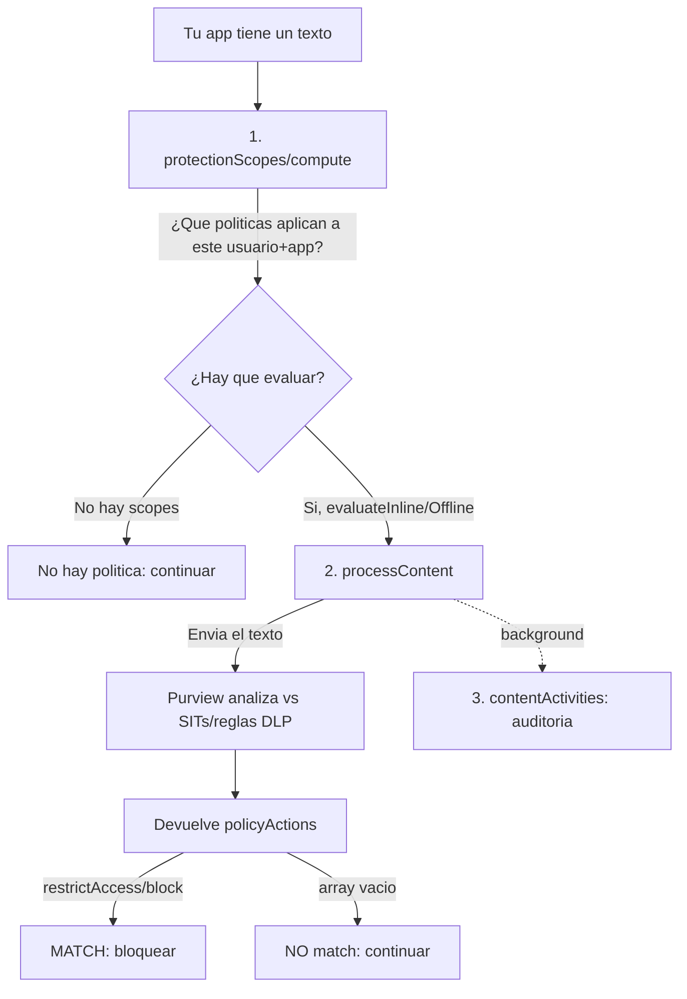

# purview-sdk

Proyecto de exploración de las capacidades del **"Purview SDK"** aplicadas a la protección de datos,
concretamente a la **Data Loss Prevention (DLP)** sobre texto.

## Objetivo del repositorio

Construir un **cliente** (uno en **Python** y otro en **Bash/PowerShell**) al que se le pueda pasar
un texto y que responda si ese texto **hace match o no** con una **política DLP** de Microsoft Purview,
devolviendo además las **acciones** que la política determina (bloquear, auditar, etc.).

Es un proyecto de exploración: prioriza entender el funcionamiento de las APIs frente a construir un
producto cerrado.

## Qué es (y qué no es) el "Purview SDK"

El nombre induce a error: **no existe una librería instalable** llamada "Purview SDK". Lo que Microsoft
llama así es un **conjunto de llamadas REST a Microsoft Graph**, bajo la ruta
`/dataSecurityAndGovernance`. No se instala con `pip`; se **invoca por HTTP**.

Por eso el cliente solo necesita utilidades genéricas:

- **azure-identity** — obtener el token (`ClientSecretCredential`).
- **httpx** — hacer las llamadas REST a Graph (beta).
- **python-dotenv** — cargar la configuración desde `.env`.

> No confundir con el paquete PyPI `azure-purview-*` (catálogo / scanning / gobernanza del *data map*),
> que **no** sirve para evaluar DLP de texto.

## Las llamadas de Graph utilizadas y su objetivo

Todas cuelgan de `/users/{userId}/dataSecurityAndGovernance/` (API en **beta**):

| Llamada de Graph | Objetivo |
|---|---|
| `POST protectionScopes/compute` | Calcular **qué políticas** aplican a ese usuario + app y **cómo** evaluarlas (`evaluateInline` / `evaluateOffline`). Devuelve un `ETag` que se cachea. |
| `POST processContent` | Enviar el **texto** para evaluarlo contra las reglas DLP. Devuelve `policyActions`: si trae `restrictAccess/block` hay **match**; si el array está vacío, **no** hay match. |
| `POST contentActivities` | Registrar la interacción para **auditoría/gobernanza** (Activity Explorer, DSPM for AI, eDiscovery, Insider Risk...). Es asíncrono y **no** decide el match. |

## Flujo de una evaluación



## Cacheo de políticas con `ETag`

`protectionScopes/compute` solo necesita llamarse **una vez** por usuario + app: su resultado no
cambia entre mensajes. Para no recalcularlo en cada evaluación se usa un **`ETag`**, que es un
identificador de la **versión del estado de las políticas** de ese usuario + app:

1. `protectionScopes/compute` devuelve un `ETag` en la cabecera de respuesta; el cliente lo **cachea**.
2. En cada `processContent` se envía ese valor en la cabecera **`If-None-Match`**.
3. Purview compara versiones:
   - Si **no ha cambiado** nada, procesa el contenido con normalidad.
   - Si un administrador **modificó** las políticas, la respuesta incluye
     `protectionScopeState: "modified"`, señal de que el cliente debe **volver a llamar a
     `compute`** para refrescar los scopes (y obtener un nuevo `ETag`).

Es el mismo concepto del `ETag` de HTTP (validación condicional de caché), aplicado aquí al estado
de las políticas DLP. Aporta **eficiencia** (una sola llamada a `compute`, no una por mensaje) y
**coherencia** (evita seguir evaluando con políticas caducadas).

## Punto clave: Service Principal vs. identificador de usuario

Hay **dos identidades distintas** en juego, y es fácil confundirlas:

1. **El Service Principal / App Registration → asocia la aplicación a la política.**
   La política DLP se define con una **Location** = `appId` de la App Registration
   (`LocationType: Individual`, `LocationSource: Entra`). Cuando el cliente llama a Graph, se
   **identifica** con ese `appId` (campo `applicationLocation`), y Purview lo compara con la Location
   para saber **qué reglas** aplicar. La App Registration también aporta la **autenticación**
   (secreto + los App Roles de Graph).

2. **Las llamadas de Graph esperan el identificador del USUARIO.**
   Aunque la política esté asociada al Service Principal, los endpoints son
   `/users/{userId}/dataSecurityAndGovernance/...`: el `{userId}` (object id de un usuario de Entra)
   es **obligatorio**. La evaluación **siempre** se hace **en el contexto de un usuario**, no del SP.

Por qué importa esto:

- **Base del análisis DLP**: Purview evalúa las reglas que aplican **a ese usuario** (sus grupos,
  su unidad administrativa, su nivel de riesgo en Adaptive Protection). El **alcance de usuarios** de
  la política (`Inclusions`/`Exclusions`) y el `userId` que se pasa deben ser **coherentes**: si el
  usuario no está en el alcance, `protectionScopes/compute` no devuelve la política y **no hay match**.
- **Base del análisis en background (auditoría)**: `contentActivities` registra la interacción
  **bajo ese usuario** ("el usuario X interactuó con la app Y"), alimentando Activity Explorer,
  DSPM for AI, eDiscovery e Insider Risk Management.

En consecuencia, en este proyecto el **`user_id` es un parámetro obligatorio en tiempo de ejecución**
(sin valor por defecto). En la solución final (una Azure Function) se extraerá del claim `oid` del
token del usuario autenticado y se pasará a la función de evaluación.

## Requisitos previos

- Suscripción de Azure con Microsoft Purview configurado.
- Licencia Microsoft 365 E5 (o tenant del Microsoft 365 Developer Program) y **billing pay-as-you-go**
  (sin él, las APIs devuelven `402 Payment Required`).
- Aplicación registrada en Microsoft Entra ID con secreto y los App Roles de Graph:
  `Content.Process.User`, `ProtectionScopes.Compute.User`, `ContentActivity.Write`.
- Política DLP creada para la app registrada vía PowerShell (`New-DlpCompliancePolicy` + `New-DlpComplianceRule`).

> ⚠️ **Tenant nuevo**: si vas a reproducir esto en un tenant limpio, revisa primero
> [doc/prerequisitos.md](doc/prerequisitos.md). Recoge lo que suele estar ya hecho de forma invisible
> en un tenant en uso (licencias E5, **billing pay-as-you-go**, activación de **DSPM for AI** y **Audit**),
> que es justo lo que falla en un entorno greenfield.

El procedimiento completo (registro de app, permisos, grant, Location y política/regla DLP) está en
[doc/guia-paso-a-paso.md](doc/guia-paso-a-paso.md).

## Configuración (`.env`)

Las credenciales y parámetros se leen de un fichero `.env` (excluido por `.gitignore`). Copia la
plantilla versionada [.env.copia](.env.copia) a `.env` y rellena los valores (cada variable indica
cómo obtenerla y a qué paso de la guía corresponde):

```powershell
Copy-Item .env.copia .env   # Windows / PowerShell
```
```bash
cp .env.copia .env          # Linux / macOS
```

Sus claves incluyen `AZURE_TENANT_ID`, `PURVIEW_CLIENT_ID`, `PURVIEW_CLIENT_SECRET`,
`PURVIEW_APP_LOCATION_VALUE`, `GRAPH_BASE_URL` y `GRAPH_SCOPE`. El `user_id` **no** se define aquí a
propósito (es un parámetro por llamada).

> 🔒 **Seguridad / publicación**: el `.env` real (con el secreto) **nunca** se versiona. Si el secreto
> se expone en algún momento, rótalo con `az ad app credential reset`. Los identificadores concretos
> del tenant en la documentación están **enmascarados** (`<APP_ID>`, `<TENANT_ID>`, ...).

## Stack y estructura del proyecto

- **Python** — cliente y lógica de evaluación.
- **Shell scripts** (PowerShell / Bash) — cliente alternativo y utilidades.

```
README.md
requirements.txt        # azure-identity, httpx, python-dotenv
.env.copia              # plantilla de configuracion (versionada, sin secretos)
.env                    # configuracion local (no versionado)
data/
  muestras.txt          # textos de prueba: unos hacen match DLP, otros solo auditables
doc/
  prerequisitos.md      # requisitos para un tenant nuevo
  guia-paso-a-paso.md   # registro de app, permisos, Location y politica DLP
scripts/
  Invoke-PurviewDlpTest.ps1     # cliente de prueba (PowerShell)
  invoke_purview_dlp_test.py    # cliente de prueba (Python)
```

## Estado

- Repositorio inicializado con entorno virtual (`.venv`, Python 3.12) y dependencias instaladas.
- Entorno de Entra/Purview configurado (app `Demo-Purview-sdk`, política `DLP-Demo-Purview-SDK` que
  bloquea números de tarjeta de crédito).
- Muestras de prueba disponibles en [data/muestras.txt](data/muestras.txt).
- **Pendiente**: implementación del cliente (`evaluate_text(text, user_id)`) en Python y Bash/PowerShell.

## Puesta en marcha

```powershell
# Windows / PowerShell
.\.venv\Scripts\Activate.ps1
.\.venv\Scripts\python.exe -m pip install -r requirements.txt
```

```bash
# Linux / macOS
source .venv/bin/activate
python -m pip install -r requirements.txt
```
