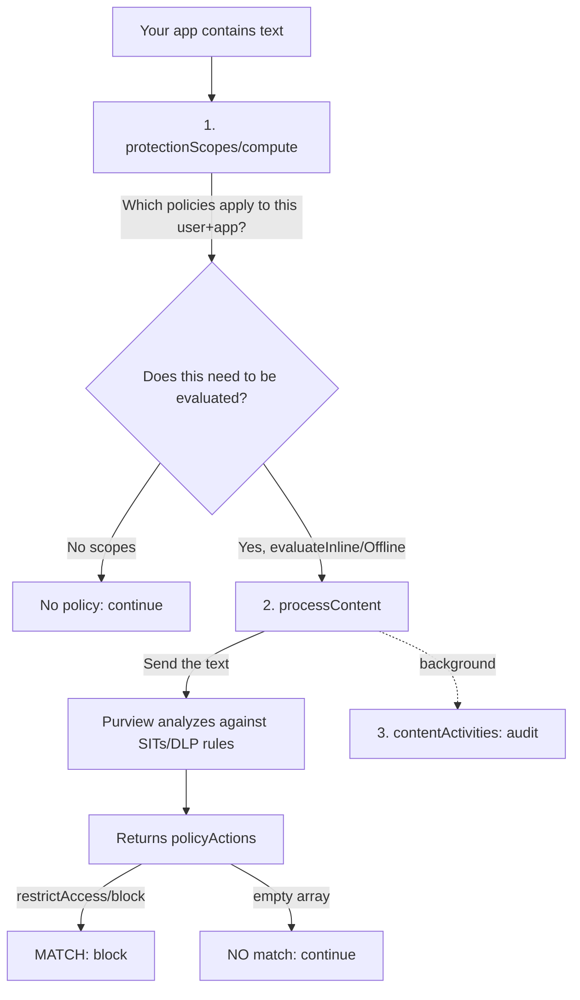

# purview-sdk

A project to explore the capabilities of the **“Purview SDK”** as applied to data protection,
specifically **Data Loss Prevention (DLP)** for text.

## Repository objective

Build a **client** (one in **Python** and another in **Bash/PowerShell**) that can be passed
a text string and that determines whether that text **matches or does not match** a Microsoft Purview **DLP policy**,
while also returning the **actions** specified by the policy (block, audit, etc.).

This is an exploration project. Its primary purpose is to understand and demonstrate the APIs and 
integration flow rather than provide a production-ready solution.

## What the “Purview SDK” Is (and Isn't)

The name is misleading: **there is no installable library** called “Purview SDK.” What Microsoft
calls that is a **set of REST calls to Microsoft Graph**, under the path
`/dataSecurityAndGovernance`. It is not installed with `pip`; it is **invoked via HTTP**.

That's why the client only needs generic utilities:

- **azure-identity** — obtain the token (`ClientSecretCredential`).
- **httpx** — make REST calls to Graph (beta).
- **python-dotenv** — load the configuration from `.env`.

> Do not confuse this with the PyPI package `azure-purview-*` (catalog / scanning / *data map* governance),
> which **is not** used for text DLP evaluation.

## Graph calls used and their purpose

They are all located under `/users/{userId}/dataSecurityAndGovernance/` (API in **beta**):

| Graph Call | Purpose |
|---|---|
| `POST protectionScopes/compute` | Calculate **which policies** apply to that user and app and **how** to evaluate them (`evaluateInline` / `evaluateOffline`). Returns an `ETag` that is cached. |
| `POST processContent` | Send the **text** to evaluate it against DLP rules. Returns `policyActions`: if it contains `restrictAccess/block`, there is a **match**; if the array is empty, there is **no** match. |
| `POST contentActivities` | Log the interaction for **auditing/governance** (Activity Explorer, DSPM for AI, eDiscovery, Insider Risk...). This is asynchronous and **does not** determine whether there is a match. |

## Evaluation Flow



## Policy Caching with `ETag`

`protectionScopes/compute` only needs to be called **once** per user + app: its result does not
change between messages. To avoid recalculating it during each evaluation, an **`ETag`** is used, which is an
identifier for the **version of the policy state** for that user + app:

1. `protectionScopes/compute` returns an `ETag` in the response header; the client **caches** it.
2. In each `processContent` call, that value is sent in the **`If-None-Match`** header.
3. Purview compares versions:
   - If nothing **has changed**, it processes the content as usual.
   - If an administrator **modified** the policies, the response includes
     `protectionScopeState: “modified”`, indicating that the client must **call
     `compute` again** to refresh the scopes (and obtain a new `ETag`).

This is the same concept as HTTP’s `ETag` (conditional cache validation), applied here to the status
of DLP policies. It provides **efficiency** (a single call to `compute`, rather than one per message) and
**consistency** (it prevents continued evaluation using expired policies).

## Key Point: Service Principal vs. User ID

There are **two distinct identities** at play, and it’s easy to confuse them:

1. **The Service Principal / App Registration → associates the application with the policy.**
   The DLP policy is defined with a **Location** = `appId` from the App Registration
   (`LocationType: Individual`, `LocationSource: Inbound`). When the client calls Graph, it
   **identifies** itself with that `appId` (`applicationLocation` field), and Purview compares it to the Location
   to determine **which rules** to apply. The App Registration also provides **authentication**
   (secret + Graph App Roles).

2. **Graph calls expect the USER’s identifier.**
   Even though the policy is associated with the Service Principal, the endpoints are
   `/users/{userId}/dataSecurityAndGovernance/...`: the `{userId}` (an Entra user’s object ID)
   is **required**. The evaluation is **always** performed **in the context of a user**, not the SP.

Why this matters:

- **Basis for DLP analysis**: Purview evaluates the rules that apply **to that user** (their groups,
  their administrative unit, their risk level in Adaptive Protection). The **user scope** of
  the policy (`Inclusions`/`Exclusions`) and the `userId` passed in must be **consistent**: if the
  user is not within the scope, `protectionScopes/compute` does not return the policy and **there is no match**.
- **Basis for background analysis (audit)**: `contentActivities` records interactions
  **under that user** (“User X interacted with App Y”), feeding Activity Explorer,
  DSPM for AI, eDiscovery, and Insider Risk Management.

Consequently, in this project, the **`user_id` is a required runtime parameter**
(with no default value). In the final solution (an Azure Function), it will be extracted from the `oid` claim of the
authenticated user’s token and passed to the evaluation function.

## Prerequisites

- An Azure subscription with Microsoft Purview configured.
- A Microsoft 365 E5 license (or a Microsoft 365 Developer Program tenant) and **pay-as-you-go billing**
  (without this, the APIs return `402 Payment Required`).
- An application registered in Microsoft Entra ID with a secret and the following Graph App Roles:
  `Content.Process.User`, `ProtectionScopes.Compute.User`, `ContentActivity.Write`.
- A DLP policy created for the registered app via PowerShell (`New-DlpCompliancePolicy` + `New-DlpComplianceRule`).

> ⚠️ **New tenant**: if you’re going to reproduce this in a clean tenant, first check
> [doc/prerequisites.md](doc/prerequisites.md). It covers what is usually already set up automatically
> in an active tenant (E5 licenses, **pay-as-you-go billing**, activation of **DSPM for AI** and **Audit**),
> which is exactly what’s missing in a greenfield environment.

The complete procedure (app registration, permissions, grant, Location, and DLP policy/rule) is in
[doc/step-by-step-guide.md](doc/step-by-step-guide.md).

## Configuration (`.env`)

Credentials and parameters are read from a `.env` file (excluded by `.gitignore`). Copy the
versioned template [.env.copy](.env.copy) to `.env` and fill in the values (each variable indicates
how to obtain it and which step in the guide it corresponds to):

```powershell
Copy-Item .env.copy .env   # Windows / PowerShell
```
```bash
cp .env.copy .env          # Linux / macOS
```

Your keys include `AZURE_TENANT_ID`, `PURVIEW_CLIENT_ID`, `PURVIEW_CLIENT_SECRET`,
`PURVIEW_APP_LOCATION_VALUE`, `GRAPH_BASE_URL`, and `GRAPH_SCOPE`. The `user_id` is **not** defined here on
purpose (it is a per-call parameter).

> 🔒 **Security / Publishing**: The actual `.env` file (containing the secret) is **never** versioned. If the secret
> is ever exposed, rotate it using `az ad app credential reset`. The specific
> tenant identifiers in the documentation are **masked** (`<APP_ID>`, `<TENANT_ID>`, ...).

## Stack and Project Structure

- **Python** — client and evaluation logic.
- **Shell scripts** (PowerShell / Bash) — alternative client and utilities.

```
README.md
requirements.txt        # azure-identity, httpx, python-dotenv
.env.copy              # configuration template (versioned, without secrets)
.env                    # local configuration (unversioned)
data/
  samples.txt          # test texts: some trigger DLP, others are only auditable
doc/
  prerequisites.md      # requirements for a new tenant
  step-by-step-guide.md   # app registration, permissions, Location, and DLP policy
scripts/
  Invoke-PurviewDlpTest.ps1     # test client (PowerShell)
  invoke_purview_dlp_test.py    # test client (Python)
```

## Status

- Repository initialized with a virtual environment (`.venv`, Python 3.12) and dependencies installed.
- Entra/Purview environment configured (`Demo-Purview-sdk` app, `DLP-Demo-Purview-SDK` policy that
  blocks credit card numbers).
- Test samples available in [data/samples.txt](data/samples.txt).
- **Pending**: client implementation (`evaluate_text(text, user_id)`) in Python and Bash/PowerShell.

## Getting Started

```powershell
# Windows / PowerShell
.\.venv\Scripts\Activate.ps1
.\.venv\Scripts\python.exe -m pip install -r requirements.txt
```

```bash
# Linux / macOS
source .venv/bin/activate
python -m pip install -r requirements.txt
```
